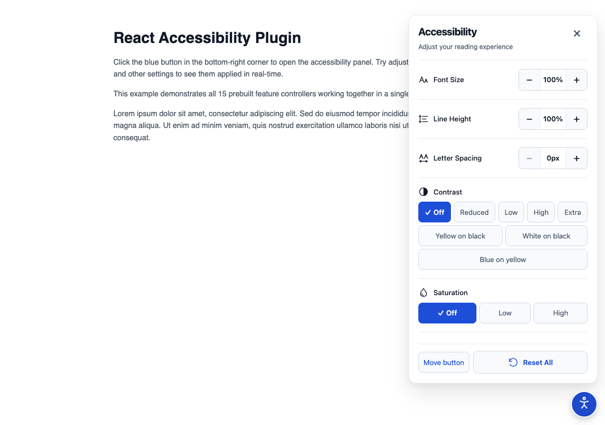
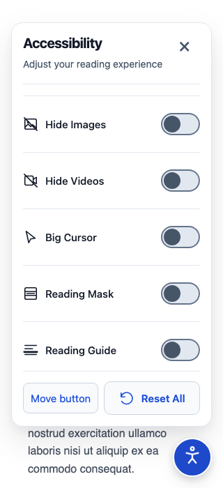
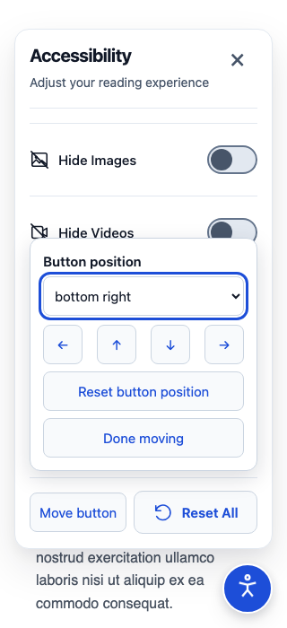

# Clean light design foundation

The owner selected the Clean light concept on 2026-10-13. It establishes the default appearance for future widget work: white surfaces, ink text, restrained blue accents, clear spacing, subtle dividers and consistent outline icons.

## Principles implemented

- 400px maximum panel width, rounded border and soft shadow. The panel fits narrow screens, safe areas and existing four placements.
- Strong heading with optional supporting description; the close control keeps its accessible name and 44px target.
- Compact label/value rows on desktop. Steppers stack below labels on small screens so neither labels nor targets are squeezed.
- Cohesive decorative SVG icons. Existing names and native controls remain the semantic interface.
- Segmented controls use explicit checks and pressed states. Toggle targets are 44px high with a smaller visual track; their selected knob also displays a check.
- A fixed blue reset action, a non-drag movement menu and clear keyboard focus, with reduced-motion and forced-colors styles.
- Scoped CSS palette variables enable future themes without a styling-framework dependency or host reset. See API.md for variables and the optional panel description.

## Reference versus implementation

The generated image is a visual reference, not a specification for reducing features. All fifteen controllers, contrast levels, link palettes and separate image/video controls remain. No nonfunctional chevrons, new nested menus or combined media preference were introduced. Consumers continue choosing tools and ordering them through JSX. The public two-argument hook, storage and effect ownership are unchanged.

Default controller names and the panel title remain compatible. The basic example opts into the shorter title “Accessibility”; the default remains “Accessibility settings”. Passing `description=""` removes the supporting text.

## Validation

Local source/test type checking, zero-warning lint, 66 unit tests, JS/declaration/CSS build and packed React18/React19/Next consumer checks passed. Browser checks passed in Chromium (including React19/Tailwind and Next), desktop WebKit and mobile WebKit: 46 passed, four intentional Next-only skips. Narrow-layout coverage verifies no horizontal overflow and minimum 44×44px button targets in every placement. Axe reported no findings in tested light/dark widget scopes. Hosted Firefox validation is recorded in the pull request checks; local Firefox remains unavailable as documented in PROJECT_STATUS.md.

The consumer script clears disposable Next build caches before verification: repacking the same unreleased version can otherwise retain stale dependency bundles. This corrects validation, not feature behavior.

Actual built-example screenshots were captured and visually inspected at 1280×900 and 320×700. These are runtime images, not generated mockups:

Human screen-reader, physical-device, actual zoom and forced-colors acceptance still apply to this design. Automated checks do not establish WCAG certification.

## Quick access and remembered placement

The header and footer stay fixed while tools scroll. ResetController uses the action bar even inside nested JSX; additional actions use AccessibilityList footer. The trigger supports dragging, Alt+arrow keys, click arrows and a corner picker, with persistent placement and separate placement reset. Short screens use a compact shell; the trigger temporarily hides while the panel is open so it cannot cover actions. See API.md for the full contract.

