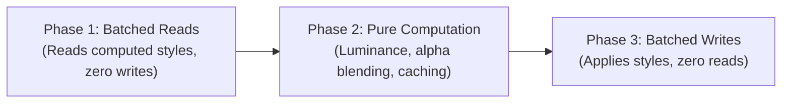

# Smart Contrast Research Prototype (A11Y-407)

## Overview

The Smart Contrast Research Prototype provides opt-in, measured contrast assistance for eligible visible elements on the host page. It measures foreground text colors against computed backdrops using WCAG 2.1 relative luminance mathematics, enhances low-contrast elements via batched non-destructive style mutations, and identifies complex or unsupported elements (such as CSS gradients, background images, and backdrop filters).

> [!WARNING]
> **Zero Automatic WCAG Compliance Claim**:
> Smart contrast is strictly an opt-in research prototype. Mathematical luminance calculations on computed styles do not constitute or certify legal, regulatory, or formal WCAG 2.1 AA/AAA compliance. Visual verification, contextual human review, and manual accessibility audits remain mandatory.

---

## Mathematical Specification

Smart contrast implements the standard W3C WCAG 2.1 relative luminance and contrast ratio algorithms.

### 1. sRGB Linearization

Each 8-bit color component ($R, G, B \in [0, 255]$) is converted to an sRGB floating-point value $c = C / 255$ and linearized:

$$
c_{linear} = \begin{cases}
\frac{c}{12.92} & \text{if } c \le 0.04045 \\
\left(\frac{c + 0.055}{1.055}\right)^{2.4} & \text{if } c > 0.04045
\end{cases}
$$

### 2. Relative Luminance ($L$)

Linearized components are weighted by human spectral sensitivity coefficients:

$$
L = 0.2126 \cdot R_{linear} + 0.7152 \cdot G_{linear} + 0.0722 \cdot B_{linear}
$$

Relative luminance ranges from $0.0$ (pure black `#000000`) to $1.0$ (pure white `#ffffff`).

### 3. Contrast Ratio ($CR$)

Given relative luminances $L_1$ and $L_2$:

$$
CR = \frac{\max(L_1, L_2) + 0.05}{\min(L_1, L_2) + 0.05}
$$

The resulting ratio is between $1.0:1$ (identical colors) and $21.0:1$ (pure black on pure white).

### 4. WCAG 2.1 Thresholds

- **Level AA (SC 1.4.3)**:
  - Normal text (< 24px, or < 18.66px if bold): $\ge 4.5:1$
  - Large text ($\ge 24px$, or $\ge 18.66px$ with font-weight $\ge 700$): $\ge 3.0:1$
- **Level AAA (SC 1.4.6)**:
  - Normal text: $\ge 7.0:1$
  - Large text: $\ge 4.5:1$

---

## Backdrop Compositing & Alpha Blending

Web pages frequently use transparent or semi-transparent backgrounds on content cards, tables, badges, and modals. Smart contrast resolves the true effective background beneath each text glyph by traversing the DOM tree upward to `document.body` and `document.documentElement`:

1. **Alpha Compositing**: Layers are composited using standard Porter-Duff source-over blending:
   $$
   \alpha_{out} = \alpha_{fg} + \alpha_{bg} \cdot (1 - \alpha_{fg})
   $$
   $$
   C_{out} = \frac{C_{fg} \cdot \alpha_{fg} + C_{bg} \cdot \alpha_{bg} \cdot (1 - \alpha_{fg})}{\alpha_{out}}
   $$
2. **Early Termination**: When an opaque ancestor background is encountered ($\alpha_{out} = 1.0$), traversal terminates immediately.
3. **Canvas Fallback**: If the document root is reached with residual transparency, it is blended over pure white (`#ffffff`).

---

## Layout Thrashing Prevention (Batching Evidence)

Interleaving `getComputedStyle()` (DOM reads) with `element.style.setProperty()` (DOM writes) in a loop causes forced synchronous layouts and layout thrashing, severely degrading 60fps frame rates.

Smart contrast strictly isolates execution into three sequential phases:

1. **Phase 1 (Batched Reads)**: Reads `computed.color`, `computed.backgroundColor`, `computed.fontSize`, `computed.fontWeight`, `computed.backgroundImage`, and `computed.backdropFilter` for all eligible nodes upfront into memory. Zero DOM mutations occur during this phase.
2. **Phase 2 (Pure Math & Compositing)**: Evaluates luminance, blends semi-transparent backdrops, parses colors with an in-memory memoization cache, and computes target replacement tokens. Zero DOM reads or writes occur during this phase.
3. **Phase 3 (Batched Writes)**: Mutates only the elements that fail target thresholds in a single write pass, simultaneously recording original styles in a restoration ledger.

### Performance Evidence

On a 1,000-node DOM fixture, full evaluation and batched application consistently completes in under **10ms**, well within the 16.6ms budget for a single 60fps animation frame.

---

## Unsupported Elements & Protections

Smart contrast refuses to make inaccurate assumptions when the backdrop cannot be measured deterministically:

| Unsupported Condition  | Detection Mechanism                                            | Handling                                                   |
| :--------------------- | :------------------------------------------------------------- | :--------------------------------------------------------- |
| **CSS Gradients**      | `linear-gradient`, `radial-gradient`, `conic-gradient`         | Skipped; flagged in audit as `reason: "gradient"`.         |
| **Background Images**  | `backgroundImage` containing `url(...)`                        | Skipped; flagged in audit as `reason: "background-image"`. |
| **Backdrop Filters**   | `backdrop-filter` or `-webkit-backdrop-filter`                 | Skipped; flagged in audit as `reason: "backdrop-filter"`.  |
| **Hidden Elements**    | `display: none`, `visibility: hidden`, `opacity: 0`            | Ignored during candidate discovery.                        |
| **Interactive States** | `:disabled`, `[aria-disabled="true"]`, `[aria-invalid="true"]` | Protected; original host semantics preserved.              |
| **Plugin UI**          | `[data-arap-ui]`, `.arap-root`, `[data-arap-ignore]`           | Strictly excluded from inspection and modification.        |

The controller exposes an inspectable **Unsupported elements** list showing each skipped element's tag, ID, class, text snippet, and rejection reason.

---

## Non-Destructive Restoration

Every modification applied by smart contrast is recorded in an undo stack:

- Original `style.color` and its CSS priority (`""` vs `"important"`) are saved.
- `undo()` cleanly restores original styles or removes the property completely.
- `data-arap-smart-contrast="true"` tracking attribute is stripped.
- Calling `undo()` multiple times is strictly idempotent and safe.

---

## Owner Promotion Decision Framework

Smart contrast is intentionally designated as a **Research Prototype** (`Prototype` pill displayed in UI) pending formal owner promotion:

1. **Host Complexity**: Complex single-page apps with high-frequency canvas/WebGL, animated CSS gradients, or dynamic video backdrops cannot be evaluated with static DOM tree climbing.
2. **Browser Color Spaces**: Modern display-P3, OKLCH, and color-mix() specifications require expanded color gamut parsing before universal promotion.
3. **User Agency**: Automated contrast overrides may alter intentional branding or artistic color palettes; users must retain explicit control to toggle between original, AA, and AAA assistance.
